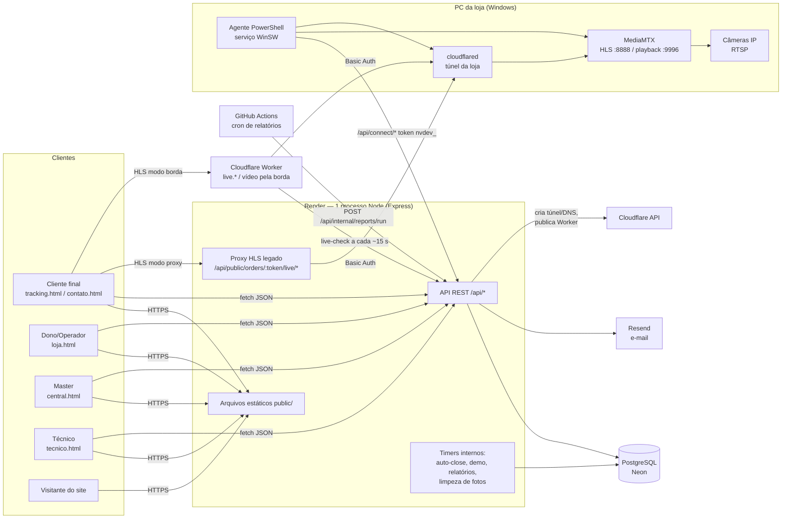
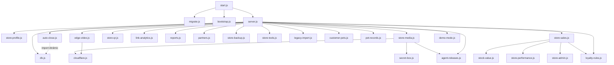
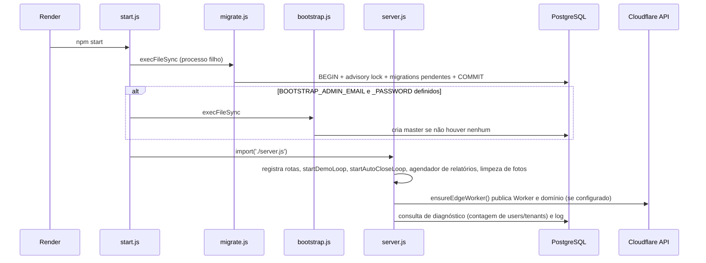
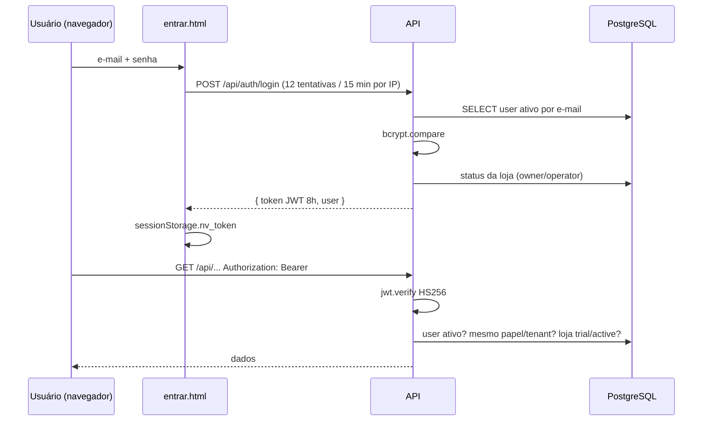
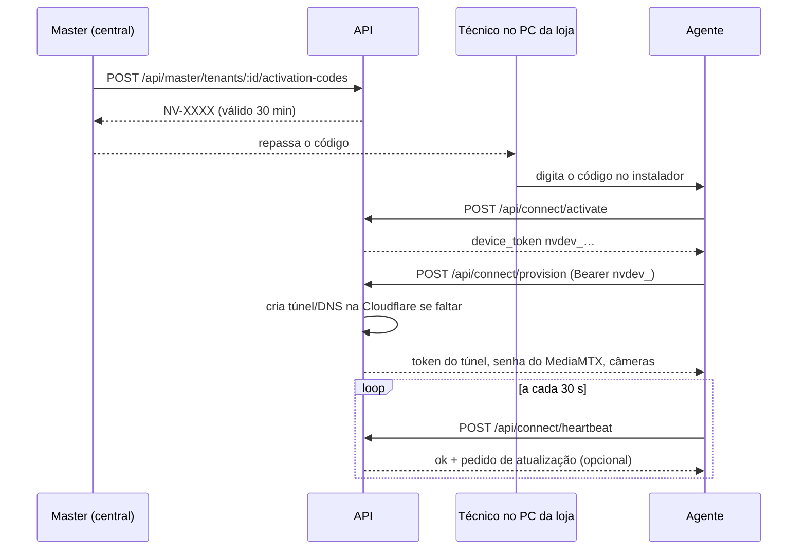
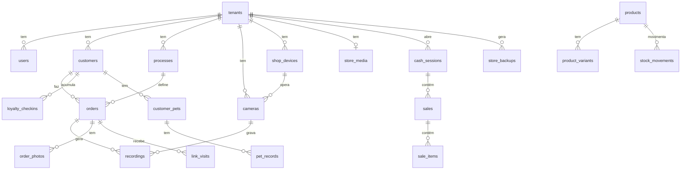
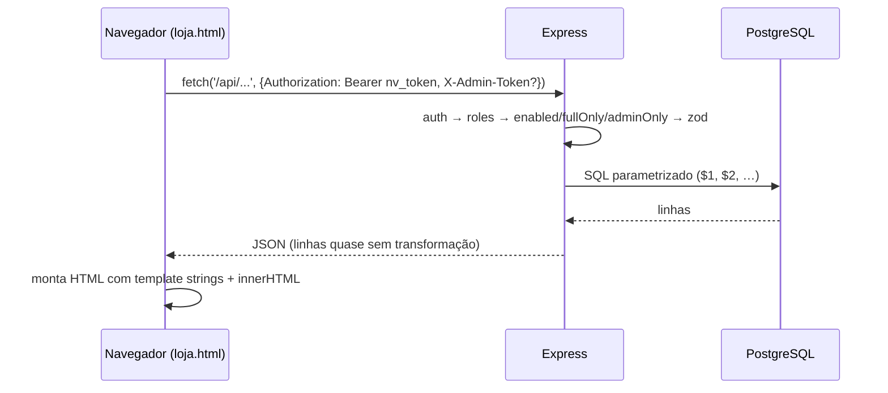
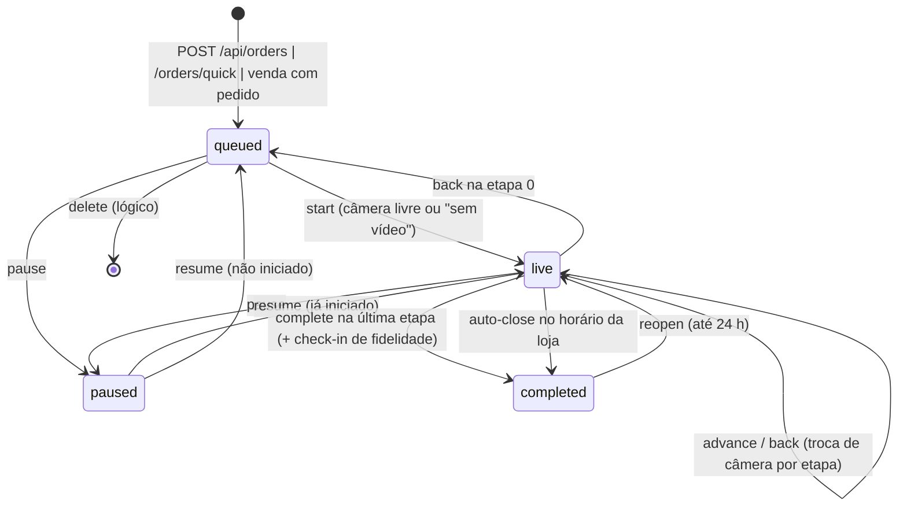
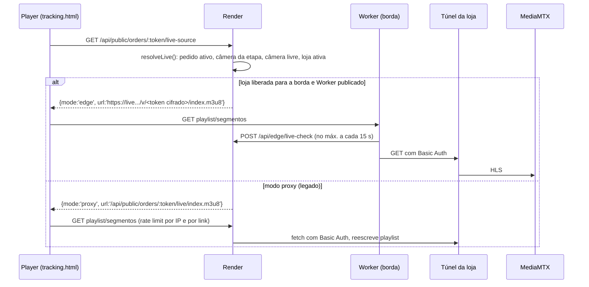
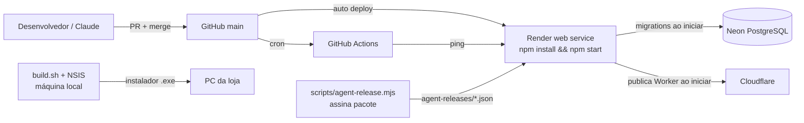

# 02 — Arquitetura atual (engenharia reversa)

> Fase 1. Tudo aqui foi reconstruído a partir do código em `develop` (= `main` @ `844b19a`).
> **[FATO]** comprovado no código · **[HIPÓTESE]** inferência a validar.
> Este documento descreve o sistema **como ele é**, não como deveria ser. Problemas são apenas sinalizados;
> a análise detalhada fica para as Fases 2–5.

## 1. Objetivo do sistema

**[FATO]** "Ficou Pronto" (código: NextVision) é um SaaS multi-tenant para lojas de serviço. Pessoas e papéis:

| Ator | Papel no código | Acesso |
|---|---|---|
| Operador da plataforma | `master` | `central.html` (`public/app.js`, `central-analytics.js`) |
| Dono da loja | `owner` | `loja.html` (painel da loja) |
| Funcionário da loja | `operator` (`access_level` `full` ou `basic`) | `loja.html` com restrições |
| Técnico instalador | `technician` | `tecnico.html` |
| Computador da loja | dispositivo (`shop_devices`) | API `/api/connect/*` com token `nvdev_…` |
| Cliente final da loja | anônimo, com link do pedido | `tracking.html` (`/p/<token>`), `contato.html` (`/<loja>/oi`) |
| Visitante do site | anônimo | `index.html`, `o-que-e`, `planos`, `segmentos`, `lojas`, … |

Funcionalidades principais: pedidos com etapas e fila, vídeo ao vivo por etapa, gravações para download,
fotos de entrada/saída, fidelidade e cashback, caixa/PDV com vendas, estoque e etiquetas, preços em lote e
por época do mês, metas e comissões, vendas a receber ("fiado"), mensagens de WhatsApp (só links `wa.me`),
prontuário de pets, QR de contato, relatórios por e-mail, backup cifrado por loja, agente Windows com
atualização remota, modo demonstração e analytics de links.

## 2. Módulos

### 2.1 Backend (`src/`)

`src/server.js` cria o app Express e define 92 rotas diretamente (239 registros `app.get/post/put/patch/delete` no total do backend, incluindo alguns middlewares registrados como rota em `store-admin.js:101-102`). Os demais módulos exportam
`registerX(app, deps)` e recebem as dependências por parâmetro (injeção manual: `q`, `db`, `auth`, `roles`,
`route`, `bad`, `valid`, `audit`, …).

| Módulo | Responsabilidade | Rotas | Leitura |
|---|---|---|---|
| `start.js` | Ponto de entrada de produção: migra, bootstrap opcional, importa `server.js` | — | integral |
| `server.js` | App Express, auth, master, técnico, câmeras, clientes, processos, pedidos, fotos, vídeo ao vivo (proxy HLS), gravações, links públicos, demo, estáticos, handler de erro, timers | 92 | integral |
| `db.js` | Pool `pg` (max 10, TLS verificado, `keepAlive`) e helper `q` | — | integral |
| `migrate.js` | Executa as 59 migrations em uma transação com advisory lock | — | integral |
| `bootstrap.js` | Cria o primeiro `master` se não existir | — | integral |
| `store-media.js` | Túnel/DNS Cloudflare por loja, provisionamento do PC, heartbeat | 5 | integral |
| `cloudflare.js` | Cliente mínimo da API Cloudflare (túnel, DNS, Worker) | — | integral |
| `edge-video.js` | Tokens AES-GCM para o Worker; publicação do Worker ao iniciar | — | integral |
| `secret-box.js` | AES-256-GCM para segredos no banco (senha MediaMTX) | — | integral |
| `store-backup.js` | Backup `.fpbak` cifrado por loja; inspeção/exportação/restauração pela central | 6 | integral |
| `agent-releases.js` | Pacotes assinados do agente e pedido de atualização via heartbeat | 4 | integral |
| `store-admin.js` | "Senha do admin" (global, via env) e preços em lote/por época | 9 + middleware | integral |
| `store-qr.js` | Página `/<loja>/oi`, captura de contato, "meus pedidos", QR SVG | 6 | integral |
| `auto-close.js` | Laço que encerra pedidos esquecidos no horário da loja | — | integral |
| `store-profile.js` | Perfis de nicho (etapas padrão) | — | integral |
| `store-sales.js` | Caixa, vendas, produtos, estoque, etiquetas, serviços, a receber, mensagens, cashback, histórico | ~70 | mapeado (rotas + cabeçalho) |
| `store-performance.js` | Metas e comissões | 3 | mapeado |
| `stock-value.js` | Valor do estoque (protegido pela senha admin) | 1 | mapeado |
| `store-tools.js` | Atalhos, links úteis, devedores ("caderninho"), importação | 18 | mapeado |
| `reports.js` | Relatórios por e-mail, agendador interno e endpoint de cron | 6 | parcial |
| `link-analytics.js` | Visitas/eventos dos links públicos, analytics da central, relatório de resultados | 14 | parcial |
| `customer-pets.js`, `pet-records.js` | Pets do cliente e prontuário | 4 + 6 | mapeado |
| `loyalty-rules.js` | Regras de fidelidade (dias/serviços que não contam) | — | mapeado |
| `demo-mode.js` | Loja de demonstração que "anda sozinha" | — | mapeado |
| `partners.js` | Mapa público de lojas parceiras | 2 | mapeado |
| `legacy-import.js` | Importação de clientes de sistema antigo | 1 | mapeado |

### 2.2 Frontend (`public/`)

Sem build, sem framework, sem módulos ES: cada página carrega scripts globais com `?v=N` para invalidar cache.

| Página | Scripts | Rota servida |
|---|---|---|
| `index.html` (site) | inline | `/` |
| `entrar.html` | inline | `/entrar` — login comum, redireciona por papel |
| `central.html` | `icons.js`, `app.js`, `central-analytics.js` | `/central` (master) |
| `loja.html` | `icons.js`, `store-ux.js`, `legacy-import.js`, `store-sales.js`, `store-tools.js`, `customer-history.js`, `pets-panel.js`, `store.js` | `/loja` (owner/operator) |
| `tecnico.html` | inline | `/tecnico` |
| `tracking.html` | inline + hls.js (jsDelivr) | `/p/:token` |
| `contato.html` | inline | `/<slug>/oi` |
| `lojas.html` | Leaflet | `/lojas` |
| `o-que-e`, `planos`, `segmentos`, `privacidade`, `fale-conosco` | inline | estáticos |
| `loja-legado.html`, `loja-preview.html` | inline | candidatos a código morto |

**[FATO]** Token de sessão em `sessionStorage` (`nv_token`, `nv_technician_token`); `localStorage` guarda
apenas preferências e identificadores de visitante (`fp_staff`, `fp_visitor`, `fp_contact`, `ft_*`).
**[FATO]** Há ~237 usos de `innerHTML` e a CSP do helmet está desligada (`src/server.js:12`) — será
analisado na Fase 3.

### 2.3 Componentes fora do servidor

| Componente | O que faz |
|---|---|
| `edge/video-worker.js` | Cloudflare Worker: abre o token AES-GCM, busca HLS no túnel da loja com Basic Auth, reescreve playlists, revalida no Render a cada ~15 s; também serve download de trecho gravado (`/d/…`) |
| `installer/windows/` | Instalador NSIS + agente PowerShell como serviço (WinSW): MediaMTX, cloudflared, ffmpeg, heartbeat, backup diário, atualizador assinado |
| `connect/windows/` | Geração anterior/alternativa do agente ("NextVision Connect", tarefa do usuário) com testes Pester-like próprios |
| `media/` | docker-compose do MediaMTX para um host de mídia (modo "legado", uma origem central) |
| `.github/workflows/reports-cron.yml` | Acorda o Render e dispara relatórios pendentes |

## 3. Diagrama de arquitetura geral

## 4. Diagrama de componentes do backend

**[FATO]** Não há camadas (controller/serviço/repositório): cada rota valida, autoriza, monta SQL e responde
na mesma função. Helpers (`auth`, `roles`, `route`, `bad`, `valid`, `audit`, `uuid`) são definidos em
`server.js` e repassados a cada `registerX`.

## 5. Fluxo de execução e inicialização

**[FATO] Pontos críticos para o ambiente de produção:**
1. `npm start` **aplica migrations automaticamente** no banco de `DATABASE_URL`.
2. Ao subir, o servidor **publica o Worker na Cloudflare** se `EDGE_VIDEO_*` e `CLOUDFLARE_*` estiverem definidos.
3. Timers internos **escrevem no banco** (encerramento automático de pedidos, demo, relatórios, apagar fotos vencidas).
4. Não há fila nem job runner; tudo roda no mesmo processo web.

Consequência: **rodar o app localmente com variáveis de produção altera o banco e a infraestrutura reais.**
Qualquer execução futura deve usar `.env` isolado (Postgres local, sem chaves Cloudflare/Resend).

## 6. Autenticação

Existem **seis mecanismos** distintos:

| # | Mecanismo | Quem | Como | Evidência |
|---|---|---|---|---|
| 1 | JWT de sessão | master/owner/operator/technician | `POST /api/auth/login` → JWT HS256 de 8 h `{id, tenant_id, role}`; enviado como `Bearer`; guardado em `sessionStorage` | `server.js:43`, `public/entrar.html` |
| 2 | Revalidação por requisição | todos os JWT | `auth` relê `users` + `tenants` a cada chamada (ativo, papel, tenant, status da loja, `access_level`) | `server.js:18-28` |
| 3 | "Senha do admin" da loja | owner/operator | `POST /api/store/admin/unlock` compara com **um único login/hash global** do ambiente (`STOCK_VALUE_*`) e devolve JWT de 15 min em `X-Admin-Token` | `store-admin.js:18-61` |
| 4 | Token de dispositivo | PC da loja | código de ativação `NV-…` (30 min, hash SHA-256) → `POST /api/connect/activate` → token `nvdev_<64 hex>` (hash SHA-256 no banco) | `server.js:47-81` |
| 5 | Links públicos do pedido | cliente final | `/p/<token>` (12 bytes aleatórios, só o hash no banco) **ou** `share_code` (12 bytes hex, **em texto puro**) **ou** link curto `/<loja>/<número de 4–5 dígitos>` que redireciona para o `share_code` | `server.js:56,437,803`; `sql/009`, `sql/020` |
| 6 | Token da borda | Worker | AES-256-GCM com `EDGE_VIDEO_KEY`, 30 min, carrega origem + **usuário/senha do MediaMTX** + token do pedido | `edge-video.js` |
| — | Chave de cron | GitHub Actions | `x-cron-key`; **se a variável não existir, o endpoint fica aberto** | `reports.js:283-287` |

**[FATO] Não existe**: recuperação de senha, troca de senha pelo próprio usuário (nenhuma rota em `src/`
altera `password_hash` depois da criação), MFA, revogação de JWT (só desativação do usuário) nem refresh token.

## 7. Autorização

- **[FATO] RBAC por papel** com o middleware `roles(...)`.
- **[FATO] Isolamento entre lojas por aplicação**: quase toda consulta inclui `tenant_id = req.user.tenant_id`.
  Não há Row-Level Security no PostgreSQL (nenhuma `CREATE POLICY` nas migrations).
- **[FATO] Níveis dentro da loja**: `owner` > `operator full` > `operator basic` (`fullOnly` em `store-sales.js:43`),
  e ações protegidas pela "senha do admin" (`adminOnly`).
- **[FATO] Recursos do caixa** só com `tenants.sales_enabled` (`enabled` em `store-sales.js:30`).
- **[FATO] Técnico** só enxerga lojas com `technician_assignments` ativas.
- **[FATO] Master** enxerga e altera tudo, sem segregação adicional.

## 8. Persistência

- **[FATO]** PostgreSQL com 48 tabelas, 2 views (`link_client_visits`, `link_insiders`), 7 funções e 5 triggers
  (número do pedido, ordem da fila, "congelar" o processo no pedido, limite de câmeras), 72 índices e
  ~126 chaves estrangeiras.
- **[FATO]** Imagens (logos, fotos de pedidos) ficam **em `bytea` no próprio banco**.
- **[FATO]** Gravações de vídeo **não** ficam no banco nem no Render: ficam no PC da loja (MediaMTX) e são
  baixadas pelo Worker.
- **[FATO]** Exclusão lógica em pedidos, clientes, processos, câmeras, produtos e regras (`deleted_at`/`archived_at`).
- **[FATO]** Auditoria em `audit_events` (quem, ação, alvo), sem IP nem dados alterados.
- **[FATO]** Retenção: fotos apagadas por `tenants.retention_days` a cada 6 h; gravações pelo MediaMTX da loja.

Principais entidades (simplificado):

## 9. Comunicação frontend ↔ backend

- **[FATO]** JSON REST sem versão, sem OpenAPI, sem paginação na maioria das listas (ex.: `GET /api/orders`, `GET /api/customers` devolvem tudo da loja).
- **[FATO]** Atualização da tela por polling no frontend **[detalhar na Fase 4]**; não há WebSocket/SSE.
- **[FATO]** Concorrência otimista em transições de pedido (`expected_step_index`/`expected_status` → 409).

## 10. Erros e exceções

- **[FATO]** `route()` encaminha rejeições para um handler único (`server.js:810`) que registra só `err.code`/`err.name` e traduz alguns códigos do Postgres (`23505`, `23503`, `P0001`) para mensagens amigáveis; o resto vira 500 genérico. Bom para não vazar dados; ruim para diagnosticar (sem stack, sem ID de correlação).
- **[FATO]** Validação devolve sempre `400 "Dados inválidos"` sem detalhar o campo.
- **[FATO]** Efeitos colaterais "fire-and-forget" (`void q(...).catch(()=>{})`) em analytics e e-mail: falhas são engolidas.
- **[FATO]** Falha na migração termina o processo com código 1 e não sobe a API.

## 11. Processamento e regras de negócio principais

### 11.1 Ciclo de vida do pedido

Cada transição: trava a linha (`FOR UPDATE`), confere a câmera com advisory lock, fecha/abre jobs de
gravação (`recordings`), grava auditoria e dispara e-mail opcional.

### 11.2 Vídeo ao vivo

### 11.3 Outros fluxos

- **Venda/caixa** (`store-sales.js`): caixa aberto → venda com itens/serviços, pagamento dividido, desconto,
  vendedor, cashback, fidelidade → pode abrir pedido ao vivo na mesma transação (`createLiveOrder`).
- **Backup**: agente pede `GET /api/connect/backup` (no máx. 1/h) → servidor lê **todas as tabelas com `tenant_id`**
  da loja, gera JSON, gzip, AES-GCM com chave derivada por loja → PC guarda o arquivo → confirma SHA-256.
  Restauração só pela central, inserindo apenas linhas faltantes.
- **Relatórios**: agendador interno (5 min) + ping do GitHub Actions; deduplicação por `report_runs`.
- **Encerramento automático**: a cada 60 s, lojas no horário têm pedidos iniciados concluídos.

## 12. Integrações externas

| Integração | Direção | Autenticação | Falha tratada? |
|---|---|---|---|
| Cloudflare API | saída | Bearer `CLOUDFLARE_API_TOKEN` | sim (erro com passo/código; timeout 15 s) |
| Cloudflare Worker | entrada (live-check) / saída (vídeo) | token AES-GCM | sim |
| Túnel da loja / MediaMTX | saída | Basic Auth por loja (senha cifrada no banco) | sim (timeout 35 s, limite 8 MB por segmento) |
| Resend | saída | Bearer `RESEND_API_KEY` | parcial (erro só no log) |
| GitHub Actions | entrada | `x-cron-key` (opcional) | — |
| ViaCEP, OSM, jsDelivr, Google Fonts | navegador | nenhuma | — |

## 13. Implantação

- **[HIPÓTESE]** Deploy automático no Render a cada push na `main` (padrão do Render; `render.yaml` não define `autoDeploy`).
- **[FATO]** Sem Docker para a API, sem staging declarado, sem pipeline de testes da API no CI (só o agente Windows é testado no CI).
- **[HIPÓTESE]** Plano do Render pode "dormir" (o cron existe para acordá-lo — comentário em `reports-cron.yml`). Isso implica **uma única instância** e timers que param quando o serviço dorme.
- **[HIPÓTESE]** Como `agent-releases/` não está no Git, os pacotes chegam ao Render por outro caminho (disco persistente ou variável `AGENT_RELEASES_DIR`). A validar com quem opera.

## 14. Pontos de entrada

| Entrada | Tipo |
|---|---|
| `npm start` → `src/start.js` | produção |
| `npm run dev` → `node --watch src/server.js` | desenvolvimento (não migra) |
| `npm run db:migrate`, `npm run db:bootstrap` | operação manual |
| ~235 rotas HTTP (`/api/*`, páginas, `/p/:token`, `/<loja>/oi`, `/<loja>/<número>`, `/demo/<loja>`) | rede |
| Timers internos (auto-close 60 s, demo 4 s, relatórios 5 min, fotos 6 h) | processo |
| `edge/video-worker.js` | Cloudflare |
| `installer/windows/payload/*.ps1`, `connect/windows/*.ps1` | PC da loja |
| `scripts/agent-release.mjs`, `scripts/site-screenshots.mjs` | ferramentas locais |

## 15. Sinais iniciais para as próximas fases (sem conclusão ainda)

| Tema | Observação | Fase |
|---|---|---|
| Segurança | CSP desligada + ~237 `innerHTML` | 3 |
| Segurança | "Senha do admin" única para todas as lojas, vinda do ambiente | 3 |
| Segurança | Endpoint de cron aberto se `REPORTS_CRON_KEY` não existir | 3 |
| Segurança | `share_code` em texto puro + link curto com número de 4–5 dígitos (≈ 9.000 combinações por loja) | 3 |
| Segurança/LGPD | Backup inclui todas as tabelas da loja, inclusive `users.password_hash` e segredos de mídia cifrados | 3 |
| Segurança | Chaves de backup e de segredos derivadas do `JWT_SECRET` quando não configuradas | 3 |
| Desempenho | `GET /api/orders` e `GET /api/customers` sem paginação, com subconsultas por linha | 4 |
| Desempenho | Fotos e logos em `bytea`; backup monta tudo em memória | 4 |
| Escalabilidade | Timers e caches em memória presumem instância única | 4 |
| Qualidade | `server.js` e `store-sales.js` (front e back) monolíticos e muito densos | 5 |
| Qualidade | Dois fusos diferentes (`America/Sao_Paulo` em `auto-close.js`, `America/Fortaleza` no resto) | 5 |
| Operação | `npm start` migra o banco e publica o Worker | 2/8 |

---

# Parte B — Auditoria de arquitetura (Fase 2)

> Avaliação do desenho atual com base nas evidências da Parte A. Cada padrão sugerido é justificado pelo
> problema concreto que resolve **neste** sistema; nada é recomendado só por ser "boa prática".

## B.1 Resumo

O sistema é um **monólito em camada única**: rota HTTP → validação zod → SQL → resposta, tudo na mesma função.
Para o tamanho atual (1 processo, ~235 rotas, dezenas de lojas) o **monólito é a escolha certa**. O problema
não é ser monólito, é **não ter fronteiras internas**. As regras de negócio são cuidadosas (transações, travas,
concorrência otimista, isolamento por loja consistente), mas ficam espalhadas e duplicadas, o que torna cada
mudança cara e arriscada.

| Dimensão | Nota (1–5) | Evidência principal |
|---|---|---|
| Separação de responsabilidades | 2 | `server.js` mistura bootstrap, auth, 92 rotas, proxy de vídeo, timers e handler de erro |
| Coesão por domínio | 3 | módulos `store-*.js` agrupam por assunto, mas `store-sales.js` cobre caixa, estoque, produtos, serviços, cashback, mensagens e histórico |
| Acoplamento | 2 | SQL e nomes de colunas repetidos em várias rotas; as mesmas tabelas são escritas por vários módulos |
| Consistência transacional | 4 | ~108 blocos com `ROLLBACK`, `FOR UPDATE`, advisory locks e 409 por concorrência |
| Isolamento multi-tenant | 4 (no código) / 1 (no banco) | filtro `tenant_id` consistente nas rotas; nenhuma RLS |
| Testabilidade | 2 | sem camada de serviço; só testes de integração ponta a ponta com Postgres e navegador reais |
| Frontend | 1–2 | scripts globais de até 316 KB, HTML por concatenação, escape duplicado em 11 arquivos |
| Operabilidade | 2 | timers no processo web, migração e publicação na Cloudflare no boot, logs mínimos |

## B.2 Separação de responsabilidades (SRP / SoC)

| Problema | Evidência | Efeito |
|---|---|---|
| Rota faz tudo | `POST /api/orders/:id/transition` (`server.js:501-545`) valida, trava, decide a máquina de estados, reserva câmera, cria gravação, fidelidade, auditoria e e-mail | a regra do ciclo do pedido não é reutilizável: `auto-close.js:20-27` e `demo-mode.js:59-62,118-120` **reimplementam** partes dela com `UPDATE orders` direto |
| Regra "câmera da etapa" duplicada | `cameraForStep` em JS (`server.js:32`) e o mesmo `CASE WHEN step_cameras ? step_index …` em SQL em `server.js:527`, `:594`, `:611` | mudar a regra exige editar 4 pontos em duas linguagens |
| Infraestrutura dentro do domínio | proxy HLS e reescrita de playlist em `server.js:619-679`; cliente Cloudflare chamado de dentro das rotas (`store-media.js`) | trocar o modo de vídeo ou o provedor mexe no arquivo central |
| Efeitos colaterais ao importar | `server.js` inicia laços e publica o Worker ao ser importado; `reports.js:295` agenda timers dentro de `registerReports` | não dá para importar módulos em teste sem disparar efeitos |
| Configuração espalhada | 38 variáveis de ambiente lidas em 12 arquivos, sem validação central | erro de configuração só aparece quando a função é usada |

## B.3 Padrões — o que se aplica e o que não

| Padrão | Aplicar? | Justificativa neste sistema |
|---|---|---|
| **Monólito modular** | **Sim** | Um deploy, um banco, equipe pequena. Basta criar fronteiras por domínio: pedidos, vídeo, caixa, estoque, clientes/pets, fidelidade, central, dispositivos. |
| **Camada de serviço (casos de uso)** | **Sim** | Resolve a triplicação do ciclo do pedido (rota, auto-close, demo) e permite testar regra sem HTTP. |
| **Repository** | Parcial | Útil para consultas reutilizadas (pedido por token, câmera ativa, cliente da loja). Não criar repositório genérico para 48 tabelas; manter SQL explícito, só centralizado. |
| **Ports & Adapters** | Só nas bordas | Vale para integrações trocáveis: Cloudflare, Resend, origem HLS/MediaMTX. No núcleo seria cerimônia sem retorno. |
| **Clean Architecture completa** | Não | Custo alto de indireção para um sistema transacional de CRUD; pouco ganho sobre "serviço + adaptadores". |
| **DDD tático** | Leve | Agregados claros: `Order` (estado, etapas, câmera), `CashSession/Sale`, `Product/Stock`. A linguagem do domínio já existe, em português, no código. |
| **Injeção de dependência** | Manter manual | `registerX(app, deps)` já é DI simples; evoluir para um único `createContext()` em vez de 12 listas de dependências diferentes. |
| **Microsserviços** | **Não** | Nenhum gargalo comprovado que exija isso; aumentaria custo, latência e risco de consistência. Único candidato futuro a processo separado: **worker de jobs** (os timers). |
| **ORM** | Não por enquanto | O SQL é parametrizado e usa recursos do Postgres (advisory locks, `jsonb`, `FOR UPDATE`, CTEs) que ORMs atrapalham. Tipagem de resultados ou um query builder leve bastam. |

## B.4 Componentização do frontend

| Problema | Evidência |
|---|---|
| Arquivos gigantes com estado global | `public/store-sales.js` (316 KB), `store.js` (108 KB), `app.js` (45 KB, linhas de 3.000 caracteres) |
| Helpers duplicados | escape HTML redefinido em 11 arquivos (`safe`/`esc`); ícones, dinheiro e telefone repetidos |
| HTML por concatenação | ~237 atribuições a `innerHTML`; a segurança depende de lembrar de escapar cada campo |
| Sem módulos | scripts globais em ordem fixa (`loja.html`), cache controlado à mão com `?v=N` |
| Sem design system | 5 CSS + muitos `style="…"` inline |
| Atualização por polling | painel da loja recarrega a lista **inteira** de pedidos a cada 5 s (`store.js:610`); página do cliente a cada ~15 s (`tracking.html:311`) |

Direção (detalhada na Fase 7): migrar **aos poucos** para módulos ES com um utilitário único de template
seguro (escape automático), começando pelo `tracking.html` (página pública, maior exposição) e pelo painel do
caixa. Avaliar framework só depois de modularizar (Fase 6).

## B.5 Estado e efeitos colaterais

- **Servidor**: estado em memória que presume **instância única**: caches (`partners.js`, `agent-releases.js`, `lastSync` em `store-admin.js:66`), contadores de rate limit (memória do processo), status do Worker (`edge-video.js`), flag `running` de `auto-close.js`. Com duas instâncias os limites dobram, os caches divergem e os timers rodam em dobro (protegidos só em parte por travas e deduplicação no banco).
- **Cliente**: estado em variáveis globais por arquivo; sincronização por polling com recarga completa.
- **Efeitos assíncronos sem garantia**: e-mail, eventos de analytics e ficha do pet rodam em "dispara e esquece" (`void …catch(()=>{})`); falhas desaparecem.

## B.6 Organização de arquivos

- `src/` plano, nomes por assunto (`store-*.js`), `server.js` concentrando tudo.
- Migrations com número repetido (`048_`) e lista mantida à mão em `migrate.js`.
- Duas gerações do agente Windows (`connect/` e `installer/`) sem documento que diga qual está em uso.
- Testes todos em `test/`, sem separação entre unidade, integração e ponta a ponta.
- `docs/` útil para operação; `README.md` obsoleto.

## B.7 Débitos arquiteturais priorizados

| ID | Débito | Impacto | Prioridade |
|---|---|---|---|
| ARQ-01 | Boot com efeitos em produção (migração automática, publicação do Worker, timers no processo web) | integridade/operação | P0/P1 |
| ARQ-02 | Ciclo de vida do pedido implementado em 3 lugares | correção de negócio | P1 |
| ARQ-03 | `server.js` monolítico, sem camada de serviço | manutenção/testes | P2 |
| ARQ-04 | Estado em memória que impede escalar horizontalmente | escalabilidade | P3 |
| ARQ-05 | Frontend sem módulos, HTML concatenado, sem CSP | segurança/manutenção | P1 (CSP) / P2 (módulos) |
| ARQ-06 | Configuração sem validação central | operação | P1 |
| ARQ-07 | Isolamento multi-tenant só no código (sem RLS) | segurança | P2 |
| ARQ-08 | Fuso inconsistente: `America/Sao_Paulo` em `auto-close.js:7`, `America/Fortaleza` nos demais | correção | P1 |
