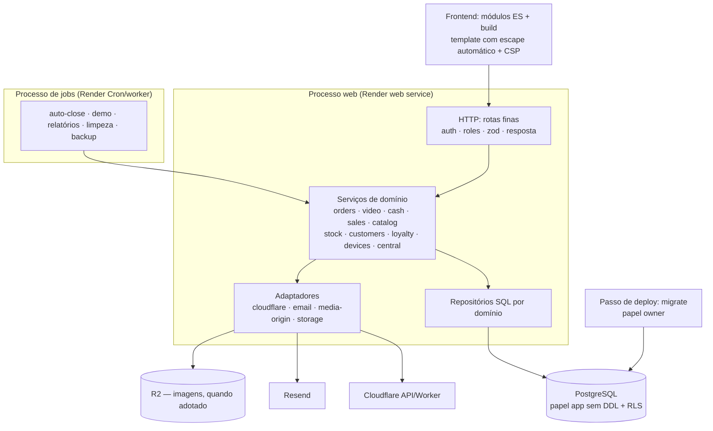
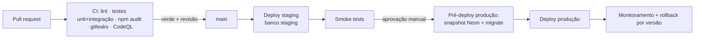

# 07 — Arquitetura-alvo (Fase 7)

> Proposta derivada das evidências das Fases 1–6. É um **destino**, alcançado em passos pequenos e
> reversíveis (ver `08-refactoring-roadmap.md`). Nenhuma etapa exige parar o sistema ou migrar dados de forma
> destrutiva.

## 1. Princípios

1. **Monólito modular**: um deploy, um banco, fronteiras claras por domínio.
2. **Regras de negócio fora das rotas**: rota = HTTP (auth, validação, resposta); serviço = regra; repositório = SQL.
3. **Integrações como adaptadores**: Cloudflare, Resend, origem de vídeo e armazenamento atrás de interfaces pequenas.
4. **Processo web sem efeitos colaterais no boot**: migração, publicação do Worker e jobs são passos explícitos.
5. **Defesa em profundidade**: CSP, RLS, papéis de banco separados, segredos independentes, logs.
6. **Mudança incremental com testes no CI** antes de cada refatoração.

## 2. Visão geral



## 3. Estrutura de pastas proposta

```text
nextvision/
├─ src/
│  ├─ main.js                      # inicia só o servidor HTTP (sem migrar, sem jobs)
│  ├─ jobs.js                      # inicia só os jobs (processo separado)
│  ├─ config/
│  │  └─ env.js                    # lê e valida TODAS as variáveis com zod; falha no boot
│  ├─ platform/                    # infraestrutura compartilhada
│  │  ├─ db.js                     # pool, q(), withTransaction(), setTenant() para RLS
│  │  ├─ http.js                   # app Express, helmet+CSP, rate limit, handler de erro, request id
│  │  ├─ auth.js                   # JWT, auth(), roles(), requireAdmin(), deviceAuth()
│  │  ├─ crypto.js                 # digestToken, seal/open com versão de chave
│  │  ├─ logger.js                 # log estruturado
│  │  └─ time.js                   # fuso único da loja
│  ├─ adapters/
│  │  ├─ cloudflare.js
│  │  ├─ email-resend.js
│  │  ├─ media-origin.js           # proxy HLS / tokens da borda
│  │  └─ storage.js                # bytea hoje, R2 depois
│  ├─ modules/
│  │  ├─ orders/                   # pedidos, fila, etapas, fotos, links públicos
│  │  │  ├─ orders.routes.js
│  │  │  ├─ orders.service.js      # máquina de estados ÚNICA (usada por rota, auto-close e demo)
│  │  │  ├─ orders.repo.js
│  │  │  └─ orders.schemas.js
│  │  ├─ public-tracking/          # /p/:token, link curto, visitas, cupom
│  │  ├─ video/                    # resolveLive, gravações, borda
│  │  ├─ devices/                  # ativação, provisionamento, heartbeat, backup, atualização do agente
│  │  ├─ customers/                # clientes, pets, prontuário, QR de contato, importações
│  │  ├─ cash/                     # caixa, movimentos, relatório
│  │  ├─ sales/                    # vendas, a receber, recibo, comissões, metas
│  │  ├─ catalog/                  # produtos, variantes, serviços, preços (lote/época)
│  │  ├─ stock/                    # estoque, etiquetas, reposição, valor
│  │  ├─ loyalty/                  # fidelidade, cashback
│  │  ├─ messaging/                # mensagens do dia (wa.me)
│  │  ├─ store-settings/           # configurações da loja, ferramentas, links úteis
│  │  ├─ identity/                 # login, troca/redefinição de senha, MFA, usuários
│  │  ├─ central/                  # master: lojas, técnicos, suporte, analytics, relatórios
│  │  └─ demo/
│  └─ jobs/
│     ├─ auto-close.job.js
│     ├─ demo.job.js
│     ├─ reports.job.js
│     └─ photo-retention.job.js
├─ db/
│  ├─ migrations/                  # mesmos arquivos SQL; runner descobre por nome e mantém os já aplicados
│  └─ roles.sql                    # documentação dos papéis owner/app
├─ web/                            # fonte do frontend
│  ├─ shared/                      # api.js, html.js (escape automático), format.js, icons.js
│  ├─ pages/
│  │  ├─ tracking/  ├─ store/  ├─ central/  ├─ technician/  └─ site/
│  └─ build.mjs                    # esbuild → public/assets/*.[hash].js
├─ public/                         # saída do build + estáticos
├─ edge/video-worker.js
├─ agent/windows/                  # uma geração só (installer/), connect/ arquivado
├─ test/
│  ├─ unit/                        # serviços sem HTTP (estado do pedido, preços, cashback)
│  ├─ integration/                 # rotas com Postgres (os atuais)
│  └─ e2e/                         # Playwright (painéis)
├─ docs/
└─ .github/workflows/ci.yml        # lint, testes, audit, gitleaks, CodeQL
```

**Por que cada mudança**:

| Mudança | Motivo (evidência) | Benefício |
|---|---|---|
| `main.js` × `jobs.js` | boot altera produção e timers no web (SEC-03, PERF-03/09) | deploy seguro; escala horizontal possível |
| `config/env.js` | 38 variáveis lidas em 12 arquivos sem validação (ARQ-06) | erro de configuração detectado no boot |
| `platform/db.js` com `withTransaction` | ~108 blocos repetidos de transação | menos código, sem vazamento de conexão |
| `modules/orders/orders.service.js` | ciclo do pedido em 3 lugares (ARQ-02) | uma regra, testável sem HTTP |
| `modules/*` por domínio | `server.js`/`store-sales.js` monolíticos (QLD-06) | revisão e testes por área |
| `adapters/` | Cloudflare/Resend/vídeo misturados às rotas | trocar provedor sem mexer em regra |
| `web/shared/html.js` | 11 escapes duplicados, sem CSP (SEC-04) | XSS por padrão impossível; CSP viável |
| `test/unit` | só testes ponta a ponta (QLD) | feedback rápido no CI |

## 4. Estratégias

### 4.1 Autenticação e autorização
- **Identidade**: troca de senha, redefinição pela central com troca obrigatória, "esqueci a senha" por e-mail com token de uso único (SEC-01); MFA TOTP obrigatório para `master` (SEC-05).
- **Sessão**: manter JWT curto (1–2 h) + `token_version` em `users` para revogar; avaliar cookie `HttpOnly` quando o frontend estiver modular (SEC-19).
- **Admin da loja**: PIN por loja com hash em `tenants`, trocável pelo dono, no lugar da senha global (SEC-06).
- **Autorização**: manter RBAC atual; centralizar as regras de nível (`owner`, `full`, `basic`) num único módulo; **RLS** por `tenant_id` como segunda barreira, com `SET LOCAL app.tenant_id` dentro de `withTransaction` (SEC-11).
- **Links públicos**: link curto com segredo; hash do `share_code`; limites por pedido além de por IP (SEC-02, SEC-17).

### 4.2 Persistência
- Papéis separados: `nextvision_owner` (migrações, DDL) e `nextvision_app` (DML, sem DDL).
- Migrations: runner descobre arquivos por ordem de nome, aceita os já aplicados (inclusive os dois `048_`), suporta passos fora de transação para `CREATE INDEX CONCURRENTLY`.
- Índices novos de `05-performance-scalability.md` §3.
- Retenção e anonimização de clientes (LGPD); backup por loja com lista explícita de tabelas/colunas.
- Antes de cada migration em produção: branch/snapshot do Neon.

### 4.3 Testes
- Pirâmide: unitários (serviços), integração (rotas + Postgres de serviço no CI), E2E (Playwright, só fluxos críticos).
- Fluxos críticos obrigatórios: login, transição de pedido, venda com caixa, link público e vídeo, provisionamento de dispositivo, backup/restauração.
- Banco de teste sempre local/efêmero; nunca `DATABASE_URL` de produção (a trava de `store-fixture.js` vira regra geral).

### 4.4 Logs e monitoramento
- Log JSON com `request_id`, rota, status, duração, `tenant_id`, `user_id` (sem dados pessoais).
- `audit_events` com IP e user-agent; eventos de segurança (login falho, link inválido, 403).
- Alertas: 5xx, latência p95, falhas de job, dispositivos offline, falhas da Cloudflare.
- `pg_stat_statements` no Neon.

### 4.5 Cache
- Navegador: assets com hash e cache imutável; API `no-store` onde há dados pessoais (já é o padrão).
- Servidor: sem Redis. Cache em memória só para dados públicos e baratos (parceiros, releases), com TTL; nada que precise ser coerente entre instâncias.
- Painel: respostas incrementais (`updated_since`) em vez de cache.

### 4.6 Escalabilidade
- Vertical primeiro; horizontal possível depois de jobs separados e rate limit em Postgres.
- Vídeo 100% pela borda (Worker), o Render fora do caminho dos bytes.
- Imagens no R2 quando o tamanho medido justificar.

### 4.7 Segurança
- CSP com nonce (report-only → enforce), scripts inline removidos, hls.js local.
- Segredos independentes e versionados (`JWT_SECRET`, `MEDIA_SECRET_KEY`, `STORE_BACKUP_KEY`, `EDGE_VIDEO_KEY`), boot falha sem eles em produção.
- Token Cloudflare mínimo; 2FA nas contas Render/Neon/Cloudflare/GitHub.
- Proteção da `main` + revisão obrigatória.

### 4.8 CI/CD



## 5. Comparação atual × proposta

| Aspecto | Atual | Proposta |
|---|---|---|
| Estrutura | `server.js` + 26 módulos planos | módulos por domínio com rota/serviço/repositório |
| Regras de negócio | dentro das rotas, duplicadas | serviços únicos e testáveis |
| Boot | migra, publica Worker, liga jobs | só serve HTTP; migração e jobs explícitos |
| Configuração | espalhada, sem validação | `config/env.js` validado |
| Isolamento de loja | só no código | código + RLS + papel sem DDL |
| Identidade | sem troca/reset, sem MFA | troca, reset, MFA master, revogação |
| Frontend | scripts globais, HTML concatenado, sem CSP | módulos, template seguro, build, CSP |
| Testes | integração local, fora do CI | pirâmide completa no CI |
| Deploy | `main` → produção | PR → CI → staging → aprovação → produção |
| Observabilidade | `console.error(err.code)` | logs estruturados, métricas, alertas |
| Escala | 1 instância obrigatória | N instâncias possíveis |
