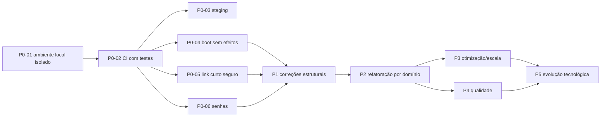

# 08 — Roadmap de execução e refatoração (Fase 8)

> Ordem pensada para **nunca** deixar a produção sem caminho de volta. Regras para todas as atividades:
> - Trabalho em branches a partir de `develop`, PR pequeno, testes no CI verdes antes do merge.
> - Nada vai para a `main` sem sua aprovação explícita.
> - Migrations só aditivas (criar coluna/índice/tabela); remoções só numa etapa posterior, depois de confirmado o não uso.
> - Toda mudança de comportamento visível tem bandeira (variável de ambiente ou coluna em `tenants`) para desligar sem deploy.
> - Antes de qualquer migration em produção: snapshot/branch do Neon.
>
> Nenhuma atividade abaixo foi iniciada. Este documento aguarda sua aprovação.

## Visão geral e dependências

## P0 — Riscos críticos de segurança e integridade

| ID | Descrição | Arquivos | Resolve | Complexidade | Dependências | Riscos | Critérios de aceite | Testes | Rollback |
|---|---|---|---|---|---|---|---|---|---|
| P0-01 | Ambiente local isolado: `.env.local.example` sem chaves Cloudflare/Resend, Postgres local (docker) com dados fictícios, script `npm run dev:local` que **recusa** host de banco não local | `package.json`, `.env.example`, `docs/` | SEC-03 (risco de rodar contra produção) | Baixa | — | nenhum na produção | rodar o app e os testes localmente sem nenhuma variável de produção; script aborta se `DATABASE_URL` não for local | executar a suíte atual localmente | apagar arquivos |
| P0-02 | CI da API: `npm ci`, Postgres de serviço, `node --test`, Playwright declarado em `devDependencies`, script `npm test` | `.github/workflows/ci.yml`, `package.json` | QLD-01, SEC-14 | Baixa | P0-01 | testes instáveis no CI | PR mostra testes verdes; `main` protegida exigindo o check | a própria suíte | desativar o workflow |
| P0-03 | Staging: segundo serviço Render + branch do Neon com dados anonimizados; deploy automático de `develop` | Render/Neon (configuração, não código) | SEC-03 | Média | P0-02 | custo; vazar dados se não anonimizar | staging sobe da `develop`, sem nenhuma chave de produção | smoke test manual | desligar o serviço |
| P0-04 | Boot sem efeitos: `start.js` deixa de migrar por padrão (`MIGRATE_ON_BOOT` para transição); migração como **pre-deploy command** do Render; publicação do Worker só com `EDGE_PUBLISH_ON_BOOT=true`; jobs só com `RUN_JOBS=true` | `src/start.js`, `src/server.js`, `src/edge-video.js`, `render.yaml` | SEC-03, ARQ-01 | Baixa | P0-02 | esquecer de migrar → API em schema antigo | em produção nada muda (variáveis ligadas); localmente o boot não altera nada | teste: iniciar sem flags não chama migrate nem Cloudflare | religar as variáveis |
| P0-05 | Link curto seguro: aceitar `/<loja>/<número>-<código>` (código aleatório de 4–6 caracteres guardado no pedido); link antigo sem código passa a mostrar **só** o estado do pedido (sem vídeo, fotos, gravações e cupom) após um período de transição controlado por bandeira; limite por loja+número; log de falhas | `src/server.js:802-807`, `sql/059_*`, `public/store.js` (montagem do link), `src/store-sales.js` (mensagens) | SEC-02 | Média | P0-02 | links já enviados por WhatsApp perderem recursos | número aleatório isolado não abre vídeo/fotos; links novos funcionam; links antigos funcionam no modo transição | integração: tentativa sem código não expõe dados; com código expõe | desligar a bandeira |
| P0-06 | Senhas: troca pelo próprio usuário; redefinição pela central com senha temporária e troca obrigatória; registro em auditoria | `src/server.js` (ou `modules/identity`), `sql/059_*` (`must_change_password`, `password_changed_at`, `token_version`), `public/entrar.html`, `public/app.js` | SEC-01 | Média | P0-02 | bloquear usuários por erro no fluxo | usuário troca a própria senha; master redefine; JWT antigo invalida após troca | integração dos três fluxos + login | bandeira esconde as telas; coluna nova é inofensiva |
| P0-07 | Validar itens dependentes de ambiente (seção 4 de `03-security-audit.md`): proxies/IP, variáveis existentes, papel do banco, token Cloudflare, backup do Neon | — (verificação) | SEC-07/09/11/12/16 | Baixa | — | — | cada item respondido e registrado no risk register | — | — |

## P1 — Correções estruturais prioritárias

| ID | Descrição | Arquivos | Resolve | Complexidade | Dependências | Riscos | Critérios de aceite | Testes | Rollback |
|---|---|---|---|---|---|---|---|---|---|
| P1-01 | Índice de auditoria por pedido + `last_change` só no modo demo | `sql/` (passo `CONCURRENTLY` fora de transação), `src/server.js:749`, `src/demo-mode.js:76` | PERF-01 | Baixa | P0-02, P0-04 (migrate separado) | criação de índice concorrente falhar e deixar índice inválido | `EXPLAIN` sem seq scan em `audit_events`; página do pedido igual | integração de `/api/public/orders/:token` | `DROP INDEX CONCURRENTLY`; reverter código |
| P1-02 | Painel incremental: `/api/orders?scope=active` + concluídos recentes; histórico paginado; parâmetro `updated_since` | `src/server.js:434`, `public/store.js:309-320,610` | PERF-02 | Média | P0-02 | pedido "sumir" da tela | telas mostram os mesmos pedidos ativos; tempo de resposta estável com histórico grande | integração + E2E do painel | parâmetro opcional: frontend antigo continua funcionando |
| P1-03 | Serviço único do ciclo do pedido usado por rota, auto-close e demo | `src/server.js:501-545`, `src/auto-close.js`, `src/demo-mode.js` → `modules/orders/orders.service.js` | ARQ-02, QLD-02 | Média | P0-02 | mudar comportamento sutil (e-mail, gravação) | testes unitários de todas as transições; auto-close e demo passam pelo serviço; comportamento documentado igual ao atual | unit + integração existentes (`order-steps`, `pet-records-autoclose`, `demo-mode`) | reverter PR |
| P1-04 | Configuração validada no boot (`config/env.js`) e fuso único configurável | todos os `src/*.js` que leem `process.env`; `auto-close.js:7` | ARQ-06, ARQ-08, QLD-03 | Baixa | P0-02 | boot falhar por variável que hoje é opcional | boot lista claramente o que falta; mesmo fuso em todo lugar | teste do módulo de config | tornar regra "aviso" em vez de erro |
| P1-05 | Segredos independentes: exigir `MEDIA_SECRET_KEY` e `STORE_BACKUP_KEY` em produção **somente se** P0-07 mostrar que já existem; senão, migrar recifrando (ler com a chave derivada, gravar com a nova, guardar versão da chave) | `src/secret-box.js`, `src/store-backup.js` | SEC-07 | Média | P0-07 | perder acesso a senhas de mídia/backups antigos | dados antigos legíveis; novos com chave versionada | teste de cifra/decifra com as duas versões | manter leitura da versão antiga |
| P1-06 | CSP em modo report-only + hls.js local + remoção gradual de scripts inline | `src/server.js:12`, `public/*.html`, `public/vendor/hls/` | SEC-04 | Média | P0-02 | quebrar telas (report-only evita) | relatórios de violação zerados nas páginas públicas | E2E das páginas | voltar `contentSecurityPolicy:false` |
| P1-07 | Backup com lista explícita (sem hashes, credenciais, auditoria e fotos); restauração não reinsere `users`/`shop_devices` | `src/store-backup.js` | SEC-08, PERF-05 | Baixa | P0-02 | backups antigos ainda contêm os dados | novo backup não contém colunas sensíveis; restauração continua funcionando com arquivos antigos | integração `store-backup` + novos casos | reverter |
| P1-08 | Segurança de login: hash fictício, MFA TOTP para master, limite por conta, eventos de login em auditoria com IP | `src/server.js:43`, `modules/identity`, `sql/` | SEC-05, SEC-15, SEC-13 | Média | P0-06 | master trancado fora (prever código de recuperação) | MFA ativo para master; login falho registrado | integração | desligar MFA por variável |
| P1-09 | Cron sempre autenticado; `/health` sem commit | `src/reports.js:283-287`, `src/server.js:42` | SEC-16, SEC-23 | Baixa | P0-07 | cron do GitHub parar se a chave não existir | ping sem chave → 401; ping do Actions funciona | integração | reverter |
| P1-10 | Rate limit com IP correto (cadeia de proxies validada) e store em Postgres para login, link curto e admin | `src/server.js:12,43,802`, `src/store-admin.js:51` | SEC-09 | Baixa | P0-07 | bloquear clientes legítimos | limites sobrevivem a deploy; IP real nos logs | integração | voltar ao MemoryStore |

## P2 — Refatorações arquiteturais

| ID | Descrição | Arquivos | Resolve | Complexidade | Dependências | Riscos | Critérios de aceite | Testes | Rollback |
|---|---|---|---|---|---|---|---|---|---|
| P2-01 | `platform/` (db com `withTransaction`, http, auth, crypto, logger) sem mudar rotas | novos arquivos; `src/server.js` passa a importar | QLD-05 | Baixa | P1 | — | nenhuma resposta de API muda | suíte completa | reverter |
| P2-02 | Extrair módulos por domínio de `server.js` (um domínio por PR: identity, central, devices, video, orders, customers, store-settings) | `src/server.js` → `src/modules/*` | ARQ-03, QLD-06 | Alta (dividida) | P2-01 | regressão em rota movida | cada PR move rotas sem alterar contrato; `server.js` < 200 linhas no fim | suíte completa por PR | reverter PR do domínio |
| P2-03 | Dividir `store-sales.js` (cash, sales, catalog, stock, receivables, loyalty, messaging) | `src/store-sales.js`, `stock-value.js`, `store-admin.js`, `store-performance.js` | QLD-06 | Alta (dividida) | P2-01 | idem | idem | idem | idem |
| P2-04 | Papéis de banco (owner × app) e RLS nas tabelas de loja, começando por `customers`, `orders`, `sales` | `db/roles.sql`, migrations, `platform/db.js` | SEC-11, ARQ-07 | Alta | P2-01, P0-03 (testar em staging) | consultas legítimas bloqueadas | testes de isolamento passam com RLS ativo; app sem DDL | integração com `foreignToken` | `ALTER TABLE … DISABLE ROW LEVEL SECURITY` |
| P2-05 | Frontend: `web/shared` (api, html com escape automático, format, icons) + esbuild; migrar `tracking.html` primeiro | `public/*`, novo `web/` | SEC-04, QLD-07, PERF-08 | Média | P1-06 | regressão visual | página do cliente idêntica; sem scripts inline; CSP enforce nela | E2E + screenshots (`scripts/site-screenshots.mjs`) | servir a versão anterior (arquivos mantidos) |
| P2-06 | Senha admin por loja (PIN) | `src/store-admin.js`, `sql/`, painel | SEC-06 | Baixa | P2-03 | lojas sem PIN travadas | dono define PIN; operadores usam o PIN da loja | integração | fallback para a senha global por bandeira |
| P2-07 | LGPD: política de retenção, anonimização de clientes excluídos, exportação dos dados do titular, aviso na página pública, fontes locais | `modules/customers`, `public/tracking.html`, `privacidade.html` | SEC-10 | Média | P2-02 | apagar dado necessário | rotina roda em staging; jurídico aprova textos | integração | desligar o job |

## P3 — Otimização e escalabilidade

| ID | Descrição | Arquivos | Resolve | Complexidade | Dependências | Riscos | Critérios de aceite | Testes | Rollback |
|---|---|---|---|---|---|---|---|---|---|
| P3-01 | Jobs como processo separado (Render Cron/worker) com trava no Postgres | `src/jobs.js`, `jobs/*`, `render.yaml` | PERF-03, PERF-09 | Média | P0-04, P1-03 | job não rodar | auto-close, relatórios e limpeza executam no horário; web sem timers | integração dos jobs | `RUN_JOBS=true` no web |
| P3-02 | Vídeo 100% pela borda | variáveis `EDGE_VIDEO_TENANTS` | PERF-06 | Baixa | validação por loja | loja sem túnel próprio | todas as lojas em `mode:edge` | `live-media`, `edge-video` | voltar a lista de lojas |
| P3-03 | Índices restantes (§3 de `05-performance-scalability.md`) após `EXPLAIN` em staging | `sql/` | PERF-07 | Baixa | P0-03 | escrita mais lenta | consultas-alvo sem seq scan | — | `DROP INDEX CONCURRENTLY` |
| P3-04 | Paginação de clientes, produtos e históricos | rotas + telas | PERF-07 | Média | P2-02/03 | quebra de telas | listas grandes respondem em tempo constante | integração + E2E | parâmetros opcionais |
| P3-05 | Imagens no R2 com fallback para `bytea` (se o tamanho medido justificar) | `adapters/storage.js` | PERF-04 | Média | P2-01 | foto inacessível | leitura com fallback; cópia em segundo plano | integração | ler só `bytea` |
| P3-06 | Observabilidade: logs estruturados, `pg_stat_statements`, alertas | `platform/logger.js`, Render/Neon | SEC-13, PERF §5 | Baixa | P2-01 | volume de logs | painel com p95 e erros; alerta testado | — | — |

## P4 — Qualidade e manutenção

| ID | Descrição | Resolve | Complexidade | Critérios de aceite |
|---|---|---|---|---|
| P4-01 | ESLint + Prettier por pasta (só arquivos tocados) | QLD-04 | Baixa | CI roda lint nos arquivos alterados |
| P4-02 | `// @ts-check` + tipos dos schemas zod nos módulos novos | QLD-08 | Média | `tsc --noEmit` sem erros nos módulos migrados |
| P4-03 | Testes unitários das regras (pedido, preços, cashback, fidelidade, comissões) | QLD | Média | cobertura medida e crescente |
| P4-04 | Remover código morto confirmado (`loja-legado`, `loja-preview`, `integration_connections`, `connect/windows` arquivado) | QLD-10 | Baixa | log de acesso confirma não uso por 30 dias |
| P4-05 | README e docs atualizados; runner de migrations por descoberta | QLD-10/11 | Baixa | README descreve setup local real |
| P4-06 | Erros de validação com campo; mensagens consistentes | QLD-09 | Baixa | frontend mostra o campo inválido |

## P5 — Evolução tecnológica

| ID | Descrição | Condição para iniciar |
|---|---|---|
| P5-01 | Express 5 (remove `route()`) | P2 concluído, suíte no CI estável |
| P5-02 | TypeScript nos módulos de domínio | P4-02 feito em ≥ 50% dos módulos |
| P5-03 | Kysely (query builder tipado) | P5-02 iniciado |
| P5-04 | SSE no painel | P1-02 medido e ainda insuficiente |
| P5-05 | Framework só para o caixa (Preact) | P2-05 concluído e caixa ainda difícil de manter |

## Ordem de execução recomendada

1. P0-07 (validar ambiente) e P0-01 (ambiente local) — **sem tocar em produção**.
2. P0-02 (CI) → P0-03 (staging).
3. P0-04, P0-05, P0-06 — cada um em PR próprio, testado em staging.
4. P1-01 e P1-02 (ganho de desempenho imediato, baixo risco).
5. P1-03 … P1-10.
6. P2 em PRs por domínio; P3 e P4 em paralelo conforme capacidade.
7. P5 apenas com as condições atendidas.
